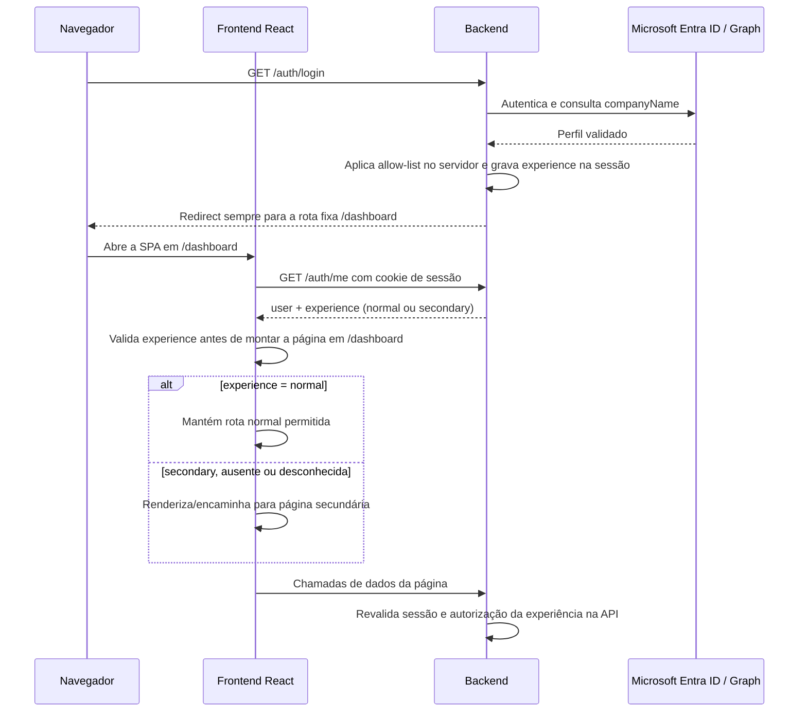

# Diagnóstico do frontend: login de página dupla

## Resumo executivo

Este repositório contém um frontend React 19 em formato SPA, com Vite e React Router. O login Microsoft é delegado ao backend: o navegador navega para `/auth/login`, e o backend retorna o usuário ao frontend. No estado atual, o callback do backend redireciona sempre para `/dashboard`; o frontend valida a sessão em `/auth/me`, solicita um JWT em `/auth/token` e, se as respostas forem válidas, renderiza a rota solicitada.

O frontend ainda não recebe nem aplica um campo de experiência/página. `RequireAuth` protege apenas a existência de uma sessão: qualquer usuário autenticado pode abrir as rotas atuais, inclusive colando URLs diretamente. Portanto, a regra de empresa autorizada versus página secundária não está implementada.

**Recomendação:** o backend deve classificar a experiência e incluir um valor explícito e validado em `/auth/me`, além de redirecionar o callback para um caminho fixo da experiência correspondente. O frontend deve manter a decisão somente em memória, carregar a experiência antes de montar páginas, encaminhar rotas e URLs diretas para a página correta e tratar valor ausente/desconhecido com fallback para a página secundária. O backend continua responsável por proteger os dados e endpoints; uma guarda React, sozinha, não é autorização de segurança.

O backend descrito no diagnóstico anexado não está neste repositório. Ele informa que `/auth/me` hoje retorna perfil/grupos sem `experience`, que o callback redireciona sempre a `/dashboard` e que há outro fluxo de login JWT. Esses pontos precisam ser confirmados e implementados no repositório do backend, em coordenação com este frontend.

## Estrutura atual do frontend (com arquivos citados)

### Stack e organização

- React 19, React DOM, React Router 7 e Vite 8; JavaScript/JSX, CSS Modules e estilos globais. Dependências e comandos estão em [`package.json`](./package.json).
- O frontend é uma SPA, não usa templates server-side. [`index.html`](./index.html) entrega o elemento `#root`; [`src/main.jsx`](./src/main.jsx) monta a aplicação dentro de `BrowserRouter` e `AuthProvider`.
- [`src/App.jsx`](./src/App.jsx) declara as rotas. A tela principal de entrada após login é `/dashboard`; as demais rotas protegidas atuais são `/hosts`, `/hosts/grupo/:grupo`, `/incidentes`, `/relatorio`, `/cliente` e `/teste`. `/login` é pública; `/` redireciona para `/dashboard`, exceto no retorno de logout com `?signedOut=1`.
- As telas estão em [`src/pages/`](./src/pages), componentes reutilizáveis em [`src/components/`](./src/components), autenticação em [`src/auth/`](./src/auth), chamadas HTTP em [`src/services/`](./src/services) e estilos globais/tema em [`src/styles/`](./src/styles).
- O shell principal é [`src/layouts/MainLayout.jsx`](./src/layouts/MainLayout.jsx), que combina [`src/components/Sidebar.jsx`](./src/components/Sidebar.jsx), [`src/components/Navbar.jsx`](./src/components/Navbar.jsx) e a rota filha. A barra lateral contém links para o conjunto atual de páginas normais.
- Existe também [`src/layout/MainLayout.jsx`](./src/layout/MainLayout.jsx), em outra pasta, mas as rotas de [`src/App.jsx`](./src/App.jsx) importam o layout plural `src/layouts/`. A implementação singular não é o layout usado pelo roteamento atual.
- [`public/`](./public/) e [`src/assets/`](./src/assets/) contêm recursos estáticos; não há página secundária implementada ou rota dedicada a ela no estado examinado.

### Rotas e páginas normais

As rotas atualmente sob `RequireAuth` e `MainLayout` são:

| Rota | Componente | Observação |
| --- | --- | --- |
| `/dashboard` | [`src/pages/Dashboard.jsx`](./src/pages/Dashboard.jsx) | Painel de monitoramento atual e destino padrão pós-login. |
| `/hosts` | [`src/pages/Hosts.jsx`](./src/pages/Hosts.jsx) | Grupos/listagem de hosts. |
| `/hosts/grupo/:grupo` | [`src/pages/HostGroup.jsx`](./src/pages/HostGroup.jsx) | Hosts de um grupo. |
| `/incidentes` | [`src/pages/Incidentes.jsx`](./src/pages/Incidentes.jsx) | Incidentes ativos. |
| `/relatorio` | [`src/pages/Relatorio.jsx`](./src/pages/Relatorio.jsx) | Em construção. |
| `/cliente` | [`src/pages/Cliente.jsx`](./src/pages/Cliente.jsx) | Em construção. |
| `/teste` | [`src/pages/Teste.jsx`](./src/pages/Teste.jsx) | Diagnóstico de perfil e dados do navegador; deve ser incluído na política de rotas. |

O Dashboard consulta incidentes ativos, totais de hosts e problemas das últimas 24 horas por [`src/services/api.js`](./src/services/api.js). Ele atualiza incidentes a cada 5 segundos e totais/problemas a cada 30 segundos, pausando polling quando a aba está oculta. O layout também inclui [`src/components/GlobalSearch.jsx`](./src/components/GlobalSearch.jsx), que carrega grupos e permite navegar para uma página de grupo. A Navbar mostra dados do perfil, tenta carregar a foto e oferece logout.

## Fluxo atual pós-login

1. A tela [`src/pages/Login.jsx`](./src/pages/Login.jsx) mostra o botão “Entrar com Microsoft”. O clique chama `goToLogin()` em [`src/services/authNavigation.js`](./src/services/authNavigation.js), que navega o browser para `${API_URL}/auth/login`. Não há autenticação MSAL executada no cliente.
2. O backend conduz o fluxo Microsoft Entra e o callback. Segundo o diagnóstico anexado, o callback atual redireciona sempre para `${FRONTEND_URL}/dashboard`; não diferencia empresa nem destino.
3. Ao abrir uma rota protegida, [`src/auth/RequireAuth.jsx`](./src/auth/RequireAuth.jsx) mostra “Validando sessão...” enquanto chama `loadCurrentUser()`. Este estado de carregamento evita montar a página antes da validação inicial da sessão.
4. [`src/auth/AuthContext.jsx`](./src/auth/AuthContext.jsx) solicita `GET /auth/me`. Se a resposta contém `user`, solicita `POST /auth/token`, mantém o JWT em memória via [`src/services/http.js`](./src/services/http.js) e marca o estado como autenticado. O objeto de resposta de `/auth/me` fica em `me`; atualmente não há leitura de `experience`.
5. As chamadas HTTP incluem `credentials: "include"` (cookie de sessão). As chamadas de API que não são ignoradas também recebem `Authorization` com o JWT mantido em memória. O token não é persistido em `localStorage` ou `sessionStorage`, conforme implementação e documentação em [`src/services/http.js`](./src/services/http.js) e [`README.md`](./README.md).
6. Se `/auth/me` retornar `401` com `needsLogin: true`, `RequireAuth` navega novamente para o login do backend. Outros erros são apresentados com opção para tentar novamente e não montam a página protegida.
7. O logout em [`src/components/Navbar.jsx`](./src/components/Navbar.jsx) limpa o JWT em memória e navega para `${API_URL}/auth/logout`. A tela de login sabe mostrar o retorno `?signedOut=1`; a URL de retorno exata e a invalidação da sessão são responsabilidade/contrato do backend.

O frontend tem testes do fluxo de autenticação em [`src/auth/authFlow.test.jsx`](./src/auth/authFlow.test.jsx), incluindo início manual do login, resposta `needsLogin`, falhas de rede, obtenção do JWT, logout e renderização do perfil. Esses testes ainda não verificam uma decisão de página.

## Desenho da solução proposta (fluxo em texto ou diagrama mermaid)



**Opção recomendada:** combinar redirect do callback para uma rota fixa com a decisão persistida pelo backend na sessão e exposta em `/auth/me`. O redirect reduz navegação inicial para uma tela incorreta; a resposta de `/auth/me` é a fonte para reconciliar a rota em refresh, acesso direto e navegação interna. Evitar enviar o nome da empresa ou a lista de autorizadas para o frontend como mecanismo de decisão.

O cliente deve tratar `experience` como um enum conhecido, por exemplo `"normal"` e `"secondary"`. Não comparar `companyName` no React e não ler o JSON de empresas. Após uma resposta válida, persistir o resultado apenas no estado React/contexto em memória durante a vida da página, sem usar armazenamento editável do browser como autorização.

O redirect do backend e a guarda do frontend não substituem a autorização das APIs: qualquer usuário pode alterar a URL, inspecionar JavaScript ou chamar endpoints fora da interface.

## Contrato esperado do backend (campos/rotas que o frontend consome)

### Contrato consumido hoje

- `GET /auth/login`: inicia a autenticação Microsoft por navegação do browser.
- `GET /auth/me`: consultado com cookie de sessão pelo cliente; hoje a aplicação exige que a resposta contenha `user`.
- `POST /auth/token`: fornece o JWT usado nas chamadas protegidas atuais.
- `GET /auth/photo`: usado pela Navbar para carregar a foto do usuário.
- `GET /auth/logout`: encerra o fluxo de logout e retorna ao frontend.
- Endpoints do dashboard, grupos, hosts, incidentes e demais páginas são centralizados em [`src/services/api.js`](./src/services/api.js).

O diagnóstico do backend fornecido relata que `/auth/me` responde atualmente com `user`, `groups`, `clientIp` e `source`, e que o callback sempre aponta para `/dashboard`. O contrato real deve ser confirmado com o backend antes de codificar a integração; este repositório contém apenas o cliente.

### Contrato proposto

Adicionar a decisão à resposta autenticada de `GET /auth/me`, preservando os campos existentes:

```json
{
  "user": {
    "displayName": "Nome do usuário",
    "companyName": "Datacore"
  },
  "experience": "normal",
  "groups": [],
  "clientIp": "203.0.113.10",
  "source": "graph"
}
```

Requisitos do contrato:

- `experience` deve ser calculado exclusivamente pelo backend com base no perfil validado e na configuração privada de empresas. Valores esperados: `"normal"` ou `"secondary"`.
- Empresa autorizada, por match exato após normalização no backend, resulta em `"normal"`; empresa diferente, vazia, nula ou ausente resulta em `"secondary"`.
- Falha ao consultar Graph não é equivalente a empresa ausente. O backend deve devolver erro explícito e não aprovar a página normal. No frontend, qualquer erro ou resposta sem decisão confiável nunca pode liberar as páginas normais; apresentar a página secundária em modo seguro/erro, com retry e/ou opção de login, conforme estado da sessão.
- A lista JSON de autorizadas, tokens e credenciais não devem ser retornados ao frontend.
- O callback pode direcionar a `/dashboard` ou à rota secundária aprovada usando somente caminhos fixos sob a origem frontend configurada. O frontend sempre deve confirmar a rota com `/auth/me`.
- O JWT atual em `/auth/token` pode continuar necessário para clientes legados, mas sua emissão e validade precisam obedecer à mesma política nos endpoints. Ele não deve ser a fonte da experiência se não carregar uma decisão assinada/validada pelo backend.
- Documentar como endpoints compartilhados e o login por JWT/senha se encaixam na política. O diagnóstico do backend menciona um segundo fluxo JWT sem `companyName`; tratá-lo como superfície que requer decisão explícita, não como exceção implícita.

## Página secundária: o que criar

Não existe página ou rota secundária no frontend atual. Criar, após confirmar conteúdo e identidade visual:

- Um componente de página dedicado, por exemplo `src/pages/SecondaryPage.jsx`, e seus estilos; a experiência secundária é selecionada dentro de `/dashboard` usando `experience` de `/auth/me`.
- A renderização secundária deve exigir autenticação e decisão carregada, mas não usar o shell normal nem mostrar links para rotas normais.
- Conteúdo aprovado pelo produto para usuários de outra empresa ou sem `companyName`. Enquanto o conteúdo definitivo não for informado, uma página segura deve explicar que esta conta não tem acesso ao portal normal sem revelar dados de monitoramento.
- Um estado de erro/carregamento/retry para indisponibilidade do backend sem renderizar temporariamente Dashboard, Sidebar, pesquisa ou conteúdo normal.
- Uma forma de logout visível. É possível compartilhar a lógica de logout, mas não reutilizar automaticamente toda a Navbar atual: ela inclui busca global que consulta grupos e perfis. Reutilizar tokens de cor e estilos gerais em [`src/styles/global.css`](./src/styles/global.css) e [`src/styles/theme.css`](./src/styles/theme.css); avaliar um cabeçalho simples independente.

O [`src/layouts/MainLayout.jsx`](./src/layouts/MainLayout.jsx) contém Sidebar com navegação das páginas normais e Navbar com pesquisa global. Reutilizá-lo sem alteração na experiência secundária mostraria links que não devem ser acessíveis e iniciaria chamadas próprias da área normal. Se o produto quiser elementos compartilhados, extrair componentes visuais sem a navegação ou os dados exclusivos da área normal.

## Guarda de rotas e fallback

### Guarda recomendada

Expandir o contexto de autenticação para representar separadamente o status da sessão e a experiência carregada. Uma guarda central pode:

1. Mostrar apenas estado neutro de carregamento enquanto consulta `/auth/me`; ainda não montar layout ou página normal.
2. Para `experience === "normal"`, permitir as rotas normais e renderizar a experiência normal em `/dashboard`.
3. Para `experience === "secondary"`, renderizar a página secundária em `/dashboard` e redirecionar qualquer outra rota normal — inclusive uma URL colada, rota interna, `/` e uma entrada no histórico — para `/dashboard` usando navegação de substituição (`replace`).
4. Para campo `experience` ausente, tipo inesperado ou valor desconhecido em uma resposta de sessão válida, aplicar o padrão seguro `"secondary"`. Não inferir acesso normal a partir de `companyName` no cliente.
5. Para falha de rede/servidor ao obter a identidade ou sessão, não montar componentes normais. Exibir a tela secundária em estado limitado de erro, sem chamadas de dados normais, junto de retry e fluxo apropriado para autenticar novamente. Se o backend indicar sessão ausente com `401 needsLogin`, manter o redirecionamento para login.

`RequireAuth` atual trata autenticação, mas não verifica a rota nem a experiência. A mudança deve ser coordenada com a definição de rotas em [`src/App.jsx`](./src/App.jsx) e o estado compartilhado de [`src/auth/AuthContext.jsx`](./src/auth/AuthContext.jsx). Evitar guardas duplicadas que solicitem `/auth/me` mais de uma vez; o contexto atual já deduplica chamadas simultâneas.

### Cache, URL direta e botão voltar

- Revalidar `/auth/me` no carregamento da SPA e em refresh; não confiar em valor de `experience` em query string, hash, `localStorage`, `sessionStorage` ou cookie editável pelo JavaScript.
- Aplicar redirecionamento de substituição ao detectar rota incompatível, evitando criar uma entrada de histórico repetida para a rota que será imediatamente bloqueada. A guarda deve executar também ao navegar pelo histórico; não basta esconder links.
- Considerar respostas HTTP de conteúdo pessoal com política de cache adequada no backend. O React só protege a renderização futura: não consegue apagar captura de tela, dados já copiados nem impedir que conteúdo previamente recebido permaneça em cache do navegador.
- Ao trocar de sessão/usuário ou sair, limpar o estado de usuário, decisão e JWT em memória; recarregar a aplicação após logout para não reaproveitar estado antigo.

### Limite de segurança

As rotas são controles de UX. A garantia contra acesso a dados exige middleware no backend para as APIs da experiência normal e secundária, verificando a classificação autenticada guardada no servidor. Isso é particularmente importante porque o cliente possui autenticação por cookie e JWT, e alguns endpoints são descritos no próprio `src/services/api.js` como públicos. Uma chamada manual à API não passa pelo `RequireAuth` do React.

## Riscos e casos de borda

- **Sem página secundária definida:** não há componente, conteúdo, rota nem requisito visual dessa página no repositório. O layout compartilhado não deve expor links de acesso normal por engano.
- **Contrato ainda não implementado:** a resposta atual requerida pelo frontend só verifica `user`; se o backend começar a enviar `experience` e o cliente não for atualizado ao mesmo tempo, a decisão será ignorada. Fazer deploy coordenado ou garantir comportamento compatível por versão.
- **Callback sempre para Dashboard:** um usuário secundário pode solicitar primeiro a rota normal; é essencial que o guard aguarde a consulta e redirecione antes de montar componentes protegidos.
- **Valor ausente/inesperado:** não aceitar acesso normal. Fallback visual para secundária, com logging/telemetria não sensível para detectar incompatibilidade de versão.
- **API indisponível/Graph com erro:** manter o dashboard fechado; não transformar erro técnico em aprovação normal. A página secundária pode servir como fallback seguro com mensagem e retry, sem consultas a endpoints normais.
- **Autorização apenas no navegador:** esconder rotas ou links não impede chamadas diretas às APIs. O backend deve assegurar as operações e revisar endpoints públicos/alternativos.
- **JWT paralelo:** o token é guardado em memória e anexado às chamadas; decidir se `/auth/token`, login por senha e endpoints JWT carregam ou consultam a mesma classificação. Do contrário, pode haver bypass de autorização ou experiências divergentes.
- **Página `/teste`:** atualmente faz parte das rotas autenticadas e pode exibir dados de diagnóstico. Definir se pertence somente à experiência normal, se deve ser removida em produção ou se terá tratamento compartilhado.
- **Sessão expirada em rota secundária:** manter tratamento coerente com `401 needsLogin`; apagar estado anterior e não voltar a renderizar uma página com dados da sessão passada.
- **Botão voltar/cache:** dados já entregues ao browser não podem ser revogados por uma guarda. APIs devem revalidar cada requisição e respostas privadas devem evitar cache compartilhado.
- **Experiência alterada durante sessão:** o frontend conserva `me` em memória. Definir a frequência de revalidação (pelo menos em refresh e nova autenticação) e como invalidar uma sessão se o backend recalcular a empresa.
- **Cookies e origens:** `credentials: "include"` já está configurado pelo cliente. O domínio, `SameSite`, CORS e cookies do backend devem permitir o retorno Entra e chamadas da SPA nos ambientes implantados.
- **Polling e chamadas paralelas:** ao sair da experiência normal, desmontar páginas e cancelar/ignorar consultas em andamento para não atualizar componentes ou exibir dados obsoletos.

### Impacto e esforço estimado

Estimativa preliminar para frontend, sujeita a escopo de conteúdo e integração:

| Trabalho | Arquivos/superfícies prováveis | Esforço |
| --- | --- | --- |
| Estado de experiência, contrato e tratamento de resposta desconhecida | [`src/auth/AuthContext.jsx`](./src/auth/AuthContext.jsx), [`src/auth/RequireAuth.jsx`](./src/auth/RequireAuth.jsx), possivelmente `src/auth/RequireExperience.jsx` | 0,5–1 dia |
| Guardas e redirecionamentos para rota direta, inicial e histórico | [`src/App.jsx`](./src/App.jsx), testes de fluxo de autenticação | 0,5–1 dia |
| Nova página secundária, layout/estilos e logout | `src/pages/SecondaryPage.jsx`, CSS Module e componentes compartilháveis aprovados | 0,5–1,5 dia, depende do conteúdo |
| Testes de integração e revisão do contrato com backend | [`src/auth/authFlow.test.jsx`](./src/auth/authFlow.test.jsx), documentação operacional se acordado | 0,5–1 dia |

Esforço total provável: **2 a 4 dias de frontend**, fora implementação do backend, validação de segurança das APIs, conteúdo/design da página secundária e coordenação de deploy.

## Plano de testes

Adicionar casos ao fluxo de autenticação existente, usando mocks de `/auth/me`, `/auth/token` e dos endpoints da página:

| Cenário | Resposta/ação | Resultado esperado |
| --- | --- | --- |
| Empresa autorizada | `/auth/me` retorna `experience: "normal"` | Rotas normais, Dashboard e layout principal são exibidos. |
| Empresa não autorizada | `/auth/me` retorna `experience: "secondary"` | A página secundária é exibida em `/dashboard`; não há Sidebar nem chamadas de dados do Dashboard. |
| Empresa vazia/ausente (backend classifica) | Resposta retorna `experience: "secondary"` | Página secundária, sem inferência no frontend pelo perfil. |
| Campo `experience` ausente ou nulo | Sessão válida com `user`, sem classificação | Fallback secundário; nunca montar página normal. |
| Valor de experiência inválido/desconhecido | Ex.: `"admin"` ou número | Fallback secundário e registro de incompatibilidade sem dados sensíveis. |
| Callback para Dashboard e usuário secundário | Abrir diretamente `/dashboard` | Enquanto valida, mostrar tela neutra; após resposta, renderizar a experiência secundária sem flash do Dashboard normal. |
| Acesso direto a outra rota normal | Abrir `/hosts`, `/teste` ou outra URL com experiência secundária | Redirecionar para `/dashboard`; nenhuma API normal é chamada. |
| Navegação por botão voltar | Usuário secundário retorna a uma rota normal do histórico | Guarda reaplica a classificação e substitui/redireciona; nenhuma tela normal é montada. |
| Navegação interna/URL digitada | Tentar uma rota normal pelo Router ou URL | Resultado igual ao acesso direto, independente dos links visíveis. |
| Falha de rede/servidor em `/auth/me` | Promise rejeitada, erro 5xx ou resposta malformada | Não mostrar conteúdo normal; tela segura com erro e retry. |
| Sessão ausente/expirada | `401 { "needsLogin": true }` | Limpar JWT/estado e iniciar o login Microsoft uma única vez. |
| Erro de `/auth/token` | `/auth/me` responde, obtenção do JWT falha | Não liberar rotas dependentes de API normal; mostrar erro/fallback seguro conforme contrato definido. |
| Logout | Clicar em Sair na experiência normal ou secundária | Limpar token e experiência local, navegar ao backend e não reutilizar estado anterior. |
| Reautenticação com outra empresa | Encerrar e autenticar conta com classificação diferente | Nova resposta governa a rota; não conservar experiência anterior em memória/histórico. |
| Usuário normal | Experiência `"normal"` em `/dashboard` | Renderizar a página normal; a URL não muda a política de APIs. |
| Endpoints de dados | Chamar API diretamente sem usar a SPA | Backend nega acesso contrário à experiência, mesmo se a guarda cliente for contornada. |
| Integração com respostas legadas | Resposta válida de versão antiga sem `experience` | Fallback secundário e sem concessão temporária à experiência normal. |

Executar os testes de frontend existentes com `npm test` após a implementação. O build de produção pode ser verificado com `npm run build`; não é necessário alterar o backend neste repositório para o diagnóstico.

## Próximos passos em ordem de prioridade

1. **Confirmar o contrato com o backend:** nome exato do campo/enum, comportamento de `/auth/me` em empresa ausente e erro de Graph, redirect de callback, estado da sessão e retorno de logout.
2. **Acordar a página secundária:** caminho final, texto/conteúdo, links permitidos, uso de marca, layout e se algum recurso é compartilhado com a aplicação normal.
3. **Definir escopo de autorização backend:** proteger APIs da página normal, rever endpoints marcados como públicos e resolver login por JWT/senha antes de considerar o recurso seguro.
4. **Implementar o contexto de experiência no frontend:** validar o valor do backend, tratar ausente/desconhecido como secundário e separar sessão autenticada de classificação.
5. **Adicionar guarda central nas rotas:** cobrir todas as páginas normais, `/teste`, URL direta, refresh, raiz e navegação pelo histórico sem renderizar conteúdo incorreto durante o carregamento.
6. **Criar página secundária isolada:** não reutilizar a navegação normal integral; incluir estado seguro de erro/retry e logout.
7. **Adicionar testes dos cenários da tabela** e executar a suíte e o build.
8. **Coordenar implantação frontend/backend:** evitar versões intermediárias em que a experiência do backend não esteja no formato esperado pelo frontend.

## Dúvidas pendentes

- Qual será a rota definitiva da página secundária e qual conteúdo ela deve exibir?
- O callback sempre redirecionará para `/dashboard` e deixará o frontend redirecionar, ou o backend já poderá redirecionar para a rota secundária fixa?
- Qual é o nome/capitalização definitivos do campo da resposta (`experience`, `page`, outro) e os valores exatos?
- Se `/auth/me` falhar por indisponibilidade do Graph, a tela secundária deve exibir uma mensagem de indisponibilidade com retry, ou deve conduzir diretamente a novo login?
- A página secundária terá header/logo/logout? Pode acessar endpoints compartilhados ou nenhum endpoint atual?
- O login legado por JWT/senha atende usuários desse portal e deverá receber a mesma regra de classificação?
- O endpoint `/auth/token` e as APIs atuais já aplicarão a autorização por experiência no backend? Quais delas são realmente públicas ou compartilhadas?
- A rota `/teste` deve ser liberada apenas para a experiência normal, retirada do build de produção ou permitida às duas?
- Qual é a URL de retorno de logout efetivamente configurada no backend e quais origens/domínios serão usados em produção?
